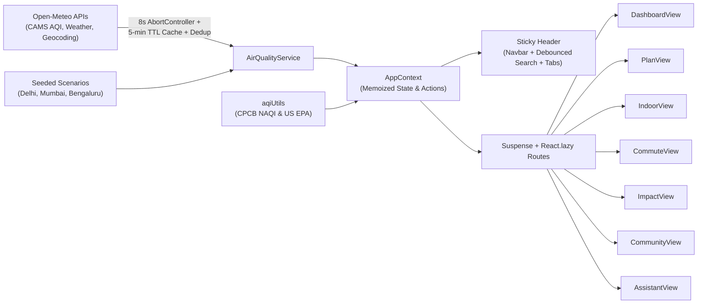

<div align="center">

# BreatheWise AI — Urban Air Quality Assistant

**A location-aware, GenAI-powered companion for safer daily routines, cleaner indoor air, and lower-impact urban commutes.**  
*Built for PromptWars 5 • Challenge 6: Urban Air Quality Assistant*

[](https://breath-wise.vercel.app/)
[](https://vitest.dev/)
[](https://www.typescriptlang.org/)
[](https://react.dev/)
[](https://vitejs.dev/)
[](https://tailwindcss.com/)

[Explore Live App](https://breath-wise.vercel.app/) • [Architecture](#-architecture--data-flow) • [Features](#-key-features--capabilities) • [Testing](#-automated-testing--verification) • [Setup](#-local-development-setup)

</div>

---

## 📌 Executive Summary

**BreatheWise AI** is a responsive, location-aware environmental health assistant designed to help urban families, commuters, and communities navigate severe winter smog and urban air pollution.

Standard air-quality applications suffer from the **"Panic-Paralysis Gap"**—they display frightening high-alert numbers (*"AQI 428 — Severe"*) with generic warnings (*"Stay indoors"*) that cause anxiety without offering realistic, schedule-aligned solutions. BreatheWise AI bridges this gap by translating real-time atmospheric data into **actionable schedule adjustments, evidence-backed zero-cost indoor hacks, and multimodal commute comparisons**.

Instead of telling users to cancel their lives, BreatheWise leverages **atmospheric diurnal temperature inversion science** to time-shift daily routines: identifying peak morning hazard traps (6:30 AM–9:00 AM) and directing errands and micro-ventilation toward cleaner afternoon solar windows (1:30 PM–3:30 PM). The platform features an interactive **Respiratory Health & Inhaled Soot Calculator**, a dynamic **Indoor Ventilation Decision Matrix**, a **Multimodal Commute Trade-off Engine**, a **One-Click WhatsApp Community Bulletin Generator** for housing societies (RWAs) and schools, and an **Audio Voice Briefing** for commuters.

Powered by public satellite and ground sensor assimilation feeds (European Copernicus CAMS via Open-Meteo) with zero mandatory API keys, BreatheWise AI provides transparent data provenance through expandable **"Why This Recommendation?" (XAI)** drawers, strict non-medical safety boundaries, and instant English/Hindi bilingual accessibility.

---

## 🚀 Key Features & Capabilities

| Module | What It Does | Core Highlights |
| :--- | :--- | :--- |
| **Air Intelligence Dashboard** | Real-time AQI, pollutant breakdown, & weather stagnation | Dual **CPCB India (NAQI)** & **US EPA** standards, data provenance badges (`LIVE_FRESH` vs `DEMO_SCENARIO`), vulnerable group toggles |
| **24-Hr Diurnal Inversion Curve** | Interactive SVG smog-wave scrubber | Adaptive Y-axis scaling (`0–200` to `0–500`), hourly temperature/PM2.5 previews, solar micro-ventilation window detection |
| **Respiratory Soot Calculator** | Pulmonary minute-ventilation exposure estimator | Models exertion (`50 L/min` running vs `12 L/min` AC Metro), mask filtration (`None`, `Cloth`, `N95`), & cigarette-equivalence proxy |
| **Personalized Daily Air Plan** | Schedule-aware routine optimizer | Time-slotted guidance (morning, commute, midday, evening, prep), custom task creation, **complete / skip / reschedule** actions |
| **Explainable AI (XAI) Assistant** | Grounded Q&A with **"Why this recommendation?"** | Cites exact environmental triggers, matched preferences, scientific mechanism, zero-cost alternatives, & stated limitations |
| **Indoor Air Defense** | Room-by-room (`bedroom`, `living`, `kitchen`, `study`, `classroom`) protection | Zero/low-cost source control hacks, interactive room PM2.5 simulator, & explicit **user-entered** sensor logbook (never inferred from outdoor AQI) |
| **Cleaner Commute Comparator** | 5-mode urban transport trade-off engine | Compares **AC Metro**, **AC Car (Recirculation)**, **CNG Auto**, **Two-Wheeler**, and **Walking/Cycling** across dose risk, time, ₹ cost, & kg CO2e |
| **Impact & Habit Proof** | Three-pillar evidence tracker | Separates **Personal Exposure**, **Indoor Defense**, & **Transport CO2e** (IPCC/CPCB factors) with a 7-day habit streak |
| **Community Bulletin & Audio** | Shareable RWA/school advisories & voice briefing | One-click WhatsApp/text export + 20-second English/Hindi Web Speech API audio summary |

---

## 🏗️ Architecture & Data Flow



### ⚡ Engineering & Performance Optimizations
- **Route-Level Code Splitting:** All 7 feature views are lazy-loaded via `React.lazy()` and `<Suspense>` with a skeleton fallback, reducing the initial app entry chunk to **56.95 kB** (`18.32 kB` gzip) alongside separated vendor chunks (`vendor-react`, `vendor-icons`).
- **API Resilience & Caching:** `AirQualityService` implements a **5-minute in-memory TTL cache**, **in-flight request deduplication**, and an **8-second `AbortController` timeout** with graceful offline fallback.
- **Debounced Geocoding:** Global city search in `Navbar` is debounced (`300ms`) with cleanup on unmount to prevent redundant network calls.
- **Render Memoization:** `AppContext` memoizes callbacks (`useCallback`), derived impact summaries, and provider values (`useMemo`), while heavy visualizers (`DiurnalCurveSection`, `LungExposureCalculator`, `ParticleSizeExplainer`, `PurposeExplainer`, `AudioBriefing`) are wrapped in `React.memo`.
- **Strict TypeScript:** Compiled with `"strict": true`, `"noUnusedLocals": true`, and `"noUnusedParameters": true` with **0 errors**.

---

## 📂 Project Structure

```text
src/
├── __tests__/               # Vitest unit & integration test suites (40 tests)
│   ├── airQualityService.test.ts
│   ├── aqiUtils.test.ts
│   ├── commute.test.ts
│   ├── components.test.tsx
│   ├── impactTracker.test.ts
│   └── indoorDefense.test.ts
├── components/
│   ├── assistant/           # Explainable AI chat & "Why this recommendation?" drawers
│   ├── common/              # User routine & preference drawer
│   ├── community/           # RWA & school WhatsApp bulletin generator
│   ├── commute/             # 5-mode exposure vs. emissions comparator
│   ├── dashboard/           # AQI gauge, diurnal curve, soot calculator, audio briefing
│   ├── impact/              # 3-pillar impact dashboard & 7-day habit tracker
│   ├── indoor/              # Room-based hacks, microclimate simulator, sensor logs
│   ├── layout/              # Responsive sticky Navbar, city search, & NavigationTabs
│   └── plan/                # Personalized daily routine planner & custom task modals
├── context/                 # AppContext (memoized global state) & ToastContext
├── data/                    # Seeded smog scenarios & indoor defense checklist
├── services/                # Open-Meteo integration with TTL cache & AbortController
├── types/                   # Strict TypeScript domain models
├── utils/                   # CPCB India & US EPA AQI formulas + bilingual metadata
├── App.tsx                  # Lazy-loaded route shell & footer
├── main.tsx                 # Application bootstrap
└── setupTests.ts            # Testing Library & Vitest DOM setup
```

---

## 🎨 Design System: Warm Earthy Aesthetic

Research shows bright red/blue emergency alert dashboards increase doomscrolling and anxiety. BreatheWise AI uses a calm, high-trust editorial design system:
- **Canvas:** Crisp white and warm alabaster (`#faf8f5`).
- **Accent Palette:** Warm Terracotta (`#ea580c`), Golden Honey (`#facc15`), Warm Amber (`#d97706`), and Earthy Espresso typography (`#26160e`).
- **Typography:** Classical serif display headers (*Fraunces*) paired with geometric sans-serif (*Plus Jakarta Sans*).

---

## 💻 Local Development Setup

```bash
# 1. Clone the repository
git clone https://github.com/Gautam-kumar01/BreathWise-AI.git
cd BreathWise-AI

# 2. Install dependencies
pnpm install

# 3. Start development server (http://localhost:3000)
pnpm run dev

# 4. Typecheck & build production bundle
pnpm exec tsc --noEmit
pnpm run build
```

---

## 🧪 Automated Testing & Verification

BreatheWise AI includes a Vitest + React Testing Library suite covering AQI math, atmospheric services, commute models, indoor defense, impact metrics, and UI accessibility (**40 / 40 tests passing**):

```bash
# Run the complete test suite
pnpm test

# Run tests in interactive watch mode
pnpm test:watch
```

| Test Suite | Coverage |
| :--- | :--- |
| [`aqiUtils.test.ts`](src/__tests__/aqiUtils.test.ts) | Indian CPCB NAQI breakpoints (0–500), US EPA breakpoints, edge boundaries, & Hindi/English health advisories |
| [`airQualityService.test.ts`](src/__tests__/airQualityService.test.ts) | Scenario retrieval (`delhi_severe`, `mumbai_coastal`, `bengaluru_clear`), 24-hr diurnal curve points, & solar window flags |
| [`commute.test.ts`](src/__tests__/commute.test.ts) | 5 urban transit modes, inhaled dose rankings, & IPCC emission factors |
| [`indoorDefense.test.ts`](src/__tests__/indoorDefense.test.ts) | All 5 room profiles, zero-cost priority, source control rules, & `isUserEntered` sensor log validation |
| [`impactTracker.test.ts`](src/__tests__/impactTracker.test.ts) | Personal exposure, indoor defense, CO2e savings math, & 7-day habit streaks |
| [`components.test.tsx`](src/__tests__/components.test.tsx) | Navbar rendering, ARIA tab roles, SVG diurnal scrubber, & biological particle explainer |

---

## 🛡️ Responsible AI & Safety Disclaimers

1. **Non-Medical Boundary:** BreatheWise AI provides environmental and routine decision support only. It does not provide clinical diagnoses, prescribe treatments, or replace medical professionals.
2. **Exposure vs. Emissions Separation:** Individual inhaled dose reduction (e.g., N95 masks, schedule shifting) is tracked separately from collective tailpipe emissions reduction (e.g., Metro transit).
3. **Data Provenance:** Every measurement explicitly identifies its station source, coordinates, freshness (`LIVE_FRESH` vs. `DEMO_SCENARIO`), and standard conversion formula. Indoor sensor readings are strictly user-entered and never inferred from outdoor AQI.

---

## 👥 Hackathon Credits
- **Event:** PromptWars 5 — Challenge 6 (Urban Air Quality Assistant)
- **Live Deployment:** [https://breath-wise.vercel.app/](https://breath-wise.vercel.app/)
- **Repository:** [https://github.com/Gautam-kumar01/BreathWise-AI](https://github.com/Gautam-kumar01/BreathWise-AI)
- **License:** MIT License
